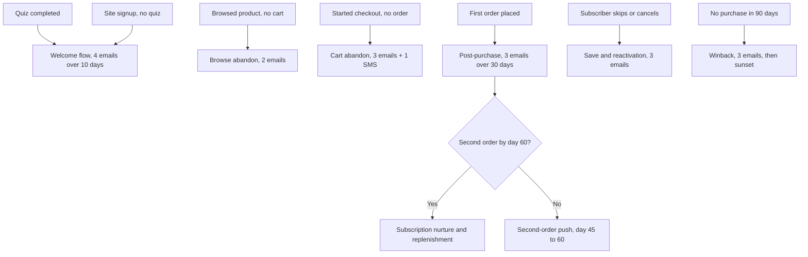

# Flow Architecture

One rule governs the whole map: every flow has exactly one job, an exit rule, and a metric it answers for. A flow that cannot name its job does not get built.

## The flows

| Flow | Trigger | Job | Length | Exit rule | Accountable metric |
|---|---|---|---|---|---|
| Welcome | Quiz complete or signup | Teach the routine, set the 90-day expectation, convert when belief lands | 4 emails, 10 days | Exits on purchase | Revenue per recipient, quiz-to-order rate |
| Browse abandon | Viewed serum page, no cart in 24h | Answer the belief objection with evidence, not urgency | 2 emails | Exits on cart or purchase | Click to cart rate |
| Cart abandon | Checkout started, no order in 4h | Remove the specific friction: price per week framing, guarantee, routine fit | 3 emails + 1 SMS | Exits on purchase | Checkout recovery rate |
| Post-purchase | Order placed | Protect the first result: correct use, week 2 and week 6 expectations | 3 emails, 30 days | Never sells until email 3 | Refund and support-ticket rate, day-30 repeat intent |
| Second-order push | Day 45 after first order, no second order | Convert the replenishment moment before it becomes churn | 2 emails | Exits on purchase | Second-order rate by day 60 |
| Subscription nurture | Subscription active | Make the 45-day interval feel right: usage check at day 30, skip made easy | Per cycle | Exits on cancel | Skip rate vs cancel rate (skips are saved revenue) |
| Save and reactivation | Skip, pause, or cancel event | Learn the reason, offer the interval fix before the discount | 3 emails | Exits on reactivation or final no | Reactivation rate within 30 days |
| Winback | 90 days, no purchase | One honest last case, then stop | 3 emails, then sunset | Sunset after flow ends | Winback revenue per recipient, list hygiene |

## Design decisions worth noticing
1. **The discount is not the welcome strategy.** Email 1 and 2 sell belief and routine. The signup offer (10%) appears in email 3, framed as a starter kit decision, because discounting first trains the list to wait for codes.
2. **Interval before incentive.** In the save flow, the first offer is a longer interval or a smaller size, not money off. Most cancellations in this model are "I have too much", not "it costs too much".
3. **SMS has one job.** A single cart-abandon SMS for people who explicitly opted in. SMS is never used for winback or broadcast pressure in this program.
4. **Sunset is a feature.** Winback ends in suppression. Sending forever to the disengaged costs deliverability that the engaged list pays for.
